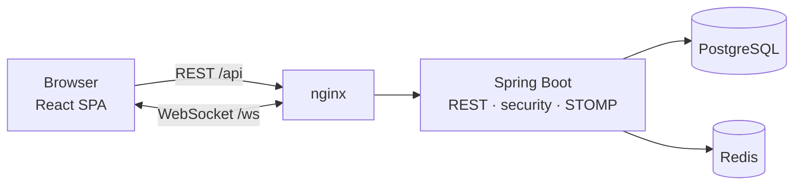

# Rendezvous

[](https://github.com/edisban/Rentezvous/actions/workflows/ci.yml)

**Rendezvous** (French for a meeting or appointment) is a full-stack booking platform. Clients find professionals (doctors, dentists, lawyers, trainers and more), book appointments and chat with them in real time. Professionals manage a public profile and accept or decline requests, which reach their dashboard the moment they're made.

## Features

- Search and filter professionals by name, specialty, area or category
- Book 30-minute slots, with double booking prevented at the database level
- Real-time booking status and chat over WebSockets, with unread badges
- Cached server data, so screens open instantly and refresh in the background
- Professional dashboard with stats and a profile editor with live preview
- Liquid-glass interface in Greek and English, with dark and light mode, on any screen size
- Account deletion that removes everything tied to the user

## Tech stack

| Layer | Technology |
| --- | --- |
| Frontend | React 19, TypeScript, Vite, Material UI, TanStack Query, STOMP.js |
| Backend | Spring Boot 4 (Java 17), Spring Security, Spring Data JPA, Spring WebSocket |
| Data | PostgreSQL 16 with Flyway; Redis for login rate limiting |
| Infrastructure | Docker Compose, nginx |
| Quality | JUnit + Testcontainers, Vitest, Playwright, GitHub Actions, Dependabot |

## Quick start

Requires [Docker](https://www.docker.com/products/docker-desktop/).

```bash
git clone https://github.com/edisban/Rentezvous.git
cd Rentezvous
docker compose up --build
```

Open **http://localhost:5173**, sign up as a professional in one browser and as a client in another (or a private window), then book and chat.

### Configuration

The app runs with development defaults. To override them, `cp .env.example .env`:

| Variable | Purpose |
| --- | --- |
| `JWT_SECRET` | Signs login tokens (32+ random characters) |
| `POSTGRES_DB` / `POSTGRES_USER` / `POSTGRES_PASSWORD` | Database credentials |
| `COOKIE_SECURE` | `true` when served over HTTPS |
| `COOKIE_SAME_SITE`, `CORS_ALLOWED_ORIGINS` | Only if the frontend is hosted on another domain |

For frontend development with hot reload, keep Docker running and use `cd frontend && npm install && npm run dev`.

## Architecture



nginx serves the React build and proxies `/api` and `/ws` to Spring Boot, so the browser uses a single origin and CORS stays off. The backend is organised by feature (`auth`, `appointment`, `message`, `provider`, `user`, `security`), and responses use DTOs, never JPA entities. On the client, TanStack Query caches server data, and live WebSocket events invalidate the affected queries so every open screen refreshes itself.

## Security

- JWT in an `HttpOnly`, `SameSite` cookie, with CSRF protection
- Argon2id hashing and a minimum password policy
- Login rate limiting per username and per IP, stored in Redis; no user enumeration
- Role and ownership checks on every action, validated input, consistent JSON errors
- Content-Security-Policy and standard security headers
- WebSocket limited to authenticated users, same origin and their own queues
- Database not exposed outside the Docker network

## Testing

| Suite | Scope | Command |
| --- | --- | --- |
| Backend integration | Full app against real PostgreSQL and Redis via Testcontainers | `cd backend && ./mvnw verify` |
| Frontend unit | Search and filtering logic (Vitest) | `cd frontend && npm test` |
| End-to-end | Two real browsers: sign up, book, live status, chat, account deletion (Playwright) | `cd frontend && npm run e2e` |

End-to-end tests run against the running app; install the browser once with `npx playwright install chromium`.

## CI/CD

GitHub Actions runs on every push and pull request: backend tests, frontend lint, tests and build, then the Playwright suite against the full Docker stack. When everything passes on `main`, the images are published to GitHub Container Registry (`ghcr.io/edisban/rendezvous-backend`, `ghcr.io/edisban/rendezvous-frontend`). Dependabot opens weekly, grouped dependency updates that go through the same pipeline.

## Project structure

```
backend/     Spring Boot API, Flyway migrations, integration tests
frontend/    React app, nginx config, unit and Playwright tests
.github/     CI/CD workflow and Dependabot
docker-compose.yml, .env.example
```

## License

MIT
