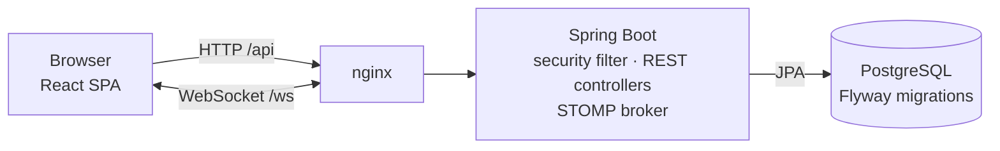
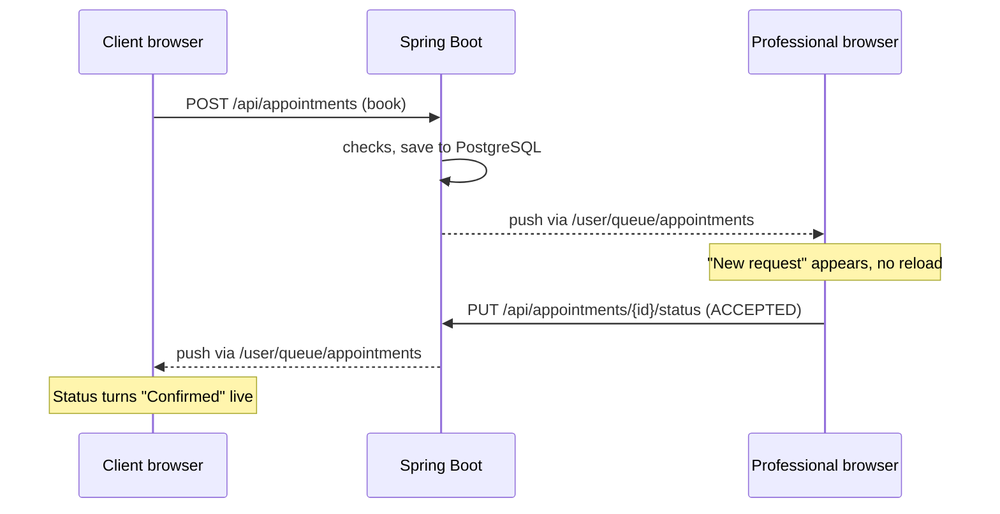

# Rantevu

[](https://github.com/edisban/Rantevu/actions/workflows/ci.yml)

**Rantevu** (Greek for "appointment") is a full-stack booking platform. Clients find professionals (doctors, dentists, therapists, lawyers, trainers and more), request appointments, and chat with them live. Professionals keep a public profile, accept or decline requests, and see new bookings appear on their dashboard the moment they're made.

https://github.com/user-attachments/assets/b31659f9-2281-4b66-8000-8ed8bcc5d8fb

## Contents

- [Features](#features)
- [Tech stack](#tech-stack)
- [Architecture](#architecture)
- [Getting started](#getting-started)
- [How it works](#how-it-works)
- [Security](#security)
- [API overview](#api-overview)
- [Project structure](#project-structure)
- [Testing](#testing)
- [CI/CD](#cicd)
- [Limitations and roadmap](#limitations-and-roadmap)

## Features

**For clients**
- Search professionals by name, specialty or area, and filter by category
- Book with a date picker and 30-minute slots; slots already taken are blocked
- See booking status (pending, confirmed, declined, cancelled) update live, and cancel when needed
- Chat live with professionals they have an appointment with

**For professionals**
- Public profile with specialty, address, price and bio, with a live preview while editing
- Dashboard with stats and pending / upcoming / all views; new requests appear live
- Accept, decline or cancel appointments; chat with clients

**For everyone**
- Sign up and sign in with a username; client or professional role
- Account page with permanent account deletion
- Greek and English, dark and light mode, glassmorphism UI in burgundy and beige, animated intro
- Works on phones, laptops and large monitors

## Tech stack

| Layer | Technology |
| --- | --- |
| Frontend | React 19, TypeScript, Vite, Material UI, React Router, STOMP.js |
| Backend | Spring Boot 4 (Java 17), Spring Security, Spring Data JPA, Spring WebSocket (STOMP), Bean Validation |
| Auth | JWT (JJWT) in an HttpOnly cookie, CSRF tokens, Argon2id password hashing |
| Database | PostgreSQL 16, schema managed by Flyway migrations |
| Infrastructure | Docker Compose, nginx (serves the app and proxies the API and WebSocket) |
| Testing | JUnit + MockMvc + Testcontainers, Vitest, Playwright |
| CI/CD | GitHub Actions, GitHub Container Registry, Dependabot |

## Architecture



The browser only ever talks to **one address**. nginx serves the built React app and forwards `/api` (REST) and `/ws` (WebSocket) to Spring Boot, so there are no cross-origin requests and CORS stays off. In development, the Vite dev server plays nginx's role with the same proxy rules.

## Getting started

### Requirements
- [Docker Desktop](https://www.docker.com/products/docker-desktop/) (everything runs in containers)
- Optional, for development and tests: Java 17 and Node 22

### Run it

```bash
git clone https://github.com/edisban/Rantevu.git
cd Rantevu
docker compose up --build
```

Open **http://localhost:5173**, sign up as a professional in one browser and as a client in another (or a private window), book an appointment and try the live chat.

| Service | Address |
| --- | --- |
| Website | http://localhost:5173 |
| API (local tools only) | http://127.0.0.1:8082 |
| Database | not published; SQL shell: `docker exec -it rantevu-db-1 psql -U rantevu -d rantevu` |

### Configuration

The app runs with no setup, using local development defaults. To change settings, copy the template and edit it (`.env` is ignored by git):

```bash
cp .env.example .env
```

| Variable | Purpose | Default |
| --- | --- | --- |
| `POSTGRES_DB`, `POSTGRES_USER`, `POSTGRES_PASSWORD` | Database credentials (applied when the database is first created) | `rantevu` |
| `JWT_SECRET` | Signs login tokens; 32+ random characters | dev-only value |
| `COOKIE_SECURE` | Send the login cookie over HTTPS only | `false` |
| `COOKIE_SAME_SITE` | `Lax`, or `None` if the frontend is on another domain | `Lax` |
| `CORS_ALLOWED_ORIGINS` | Only when the frontend runs on another domain | empty (off) |

Before deploying: replace `POSTGRES_PASSWORD` and `JWT_SECRET`, and set `COOKIE_SECURE=true` once served over HTTPS. Variables already set in your shell or operating system take priority over `.env`.

### Frontend development

Keep the database and backend running in Docker, then:

```bash
cd frontend
npm install
npm run dev
```

Vite proxies `/api` and the `/ws` socket to the backend on `localhost:8082`, and every save reloads the page instantly.

## How it works

### Sign in: JWT in an HttpOnly cookie
1. The browser fetches a CSRF token (`GET /api/auth/csrf`), then sends the username and password.
2. The backend checks the login rate limit, loads the user and verifies the password hash.
3. It creates a **JWT** (user id, role, 24-hour expiry), signed with `JWT_SECRET`, and returns it as an **HttpOnly cookie**. The JSON response only contains the role, id and name.
4. On every later request the browser sends the cookie automatically, and `JwtAuthFilter` verifies it. Nothing is stored on the server (stateless).

JavaScript can't read an HttpOnly cookie, so even an XSS bug couldn't steal the token. Because cookies are sent automatically, every POST, PUT and DELETE must also carry the CSRF token in an `X-XSRF-TOKEN` header, which other websites can't read or forge.

### Passwords: Argon2id
New passwords are hashed with **Argon2id** (the current OWASP recommendation: slow and memory-hard, so stolen hashes are expensive to crack) and stored with an `{argon2}` prefix. Accounts created before the switch still have **BCrypt** hashes. Spring Security's `DelegatingPasswordEncoder` verifies both, and at that user's next successful login their hash is upgraded to Argon2id, without anyone resetting their password.

### Booking and double-booking protection
Booking happens in three layers:
1. **UI:** the booking dialog asks for the day's taken slots and disables them.
2. **Code:** before saving, the backend checks that the slot is still free.
3. **Database:** a **partial unique index** on (professional, date) for pending and accepted bookings. Two requests at the same instant can both pass step 2 (a race condition), but PostgreSQL rejects the second insert, and a global exception handler turns that into the same friendly *409: This time slot is already taken*. Cancelled or declined bookings don't count, so the slot opens again.

Only the professional can accept or decline a pending booking; either side can cancel a pending or accepted one; any other change returns 409.

### Live updates: WebSocket + STOMP
While signed in, the browser keeps **one WebSocket connection** (`/ws`, using the STOMP protocol). The handshake is a normal HTTP request, so the login cookie authenticates it, and only the site's own origin is accepted.



- **Chat:** a message is sent with a normal REST call (`POST /api/messages/{id}`), which checks login, CSRF, validation and that the two users share an appointment. After saving, the server pushes it to both users on `/user/queue/messages`.
- **Bookings:** every new booking and status change is pushed to both people on `/user/queue/appointments`, with who made the change, so the other person gets a notification and their dashboard refreshes.
- Clients can only subscribe to their own queues and can never send over the socket.

### Database and migrations
Flyway owns the schema: versioned SQL files in `backend/src/main/resources/db/migration` (`V1` tables, `V2` double-booking index, `V3` chat read tracking) run once each, in order, on startup. Hibernate only validates that the tables match the Java entities (`ddl-auto=validate`).

## Security

| Protection | Details |
| --- | --- |
| Login token | JWT in an `HttpOnly`, `SameSite=Lax` cookie; `Secure` via `COOKIE_SECURE` |
| CSRF | Token in a readable `XSRF-TOKEN` cookie, echoed back in `X-XSRF-TOKEN` on every change |
| Passwords | Argon2id (older BCrypt hashes upgraded at login); 8+ characters with a letter and a number |
| Brute force | 5 failed logins per username or 30 per IP within 15 minutes, then 429 |
| No user enumeration | Same "Bad credentials" for an unknown user and a wrong password |
| Authorization | Ownership and role checks in the backend on every booking, status change, chat and profile action |
| Input | Bean Validation on every request body; one handler returns JSON error messages |
| Headers | Content-Security-Policy, X-Frame-Options, nosniff, Referrer-Policy, Permissions-Policy; HSTS on HTTPS |
| WebSocket | Handshake needs the login cookie and the site's own origin; users subscribe only to their own queues |
| Network | Database not exposed outside Docker; API port bound to localhost |
| Data | No password hashes or entities in responses (DTOs only); account deletion re-checks the password |

## API overview

All endpoints are under `/api`. Every POST, PUT and DELETE needs the CSRF header.

| Method | Path | Who | Purpose |
| --- | --- | --- | --- |
| GET | `/auth/csrf` | anyone | Issue the CSRF cookie |
| POST | `/auth/register/client`, `/auth/register/provider` | anyone | Create an account and sign in |
| POST | `/auth/login`, `/auth/logout` | anyone | Sign in (rate-limited) / sign out |
| DELETE | `/account` | signed in + password | Permanently delete the account and its data |
| GET | `/providers` | signed in | All professional profiles |
| GET | `/providers/{id}/busy?date=YYYY-MM-DD` | signed in | Times already taken that day |
| GET, PUT | `/profile` | signed in | Read / update my profile |
| POST | `/appointments` | client | Request an appointment |
| GET | `/appointments/mine` | signed in | My appointments, newest first |
| PUT | `/appointments/{id}/status` | client or provider of it | Accept, decline or cancel |
| GET | `/messages/contacts`, `/messages/unread` | signed in | Chat list and unread count |
| GET, POST | `/messages/{otherId}` | shared appointment | Read (marks read) / send a message |
| PUT | `/messages/{otherId}/read` | shared appointment | Mark as read |
| WS | `/ws` | login cookie | STOMP: `/user/queue/messages`, `/user/queue/appointments` |

## Project structure

```
backend/                     Spring Boot app (organised by feature)
  src/main/java/.../
    auth/                    sign up, sign in, sign out
    security/                JWT, cookie, CSRF, rate limiter, security config
    appointment/             booking, status rules, live booking events
    message/                 chat service, WebSocket/STOMP config
    provider/  profile/      public profiles and the account page
    user/                    users, account deletion
    common/                  global JSON error handler
  src/main/resources/db/migration/   Flyway SQL migrations
  src/test/java/             integration tests (Testcontainers)
frontend/                    React app
  src/pages/                 landing, dashboards, profile, messages
  src/components/            navbar, booking dialog, shared UI
  src/api.ts  chat.tsx       API client (cookies + CSRF), live connection
  src/theme.ts  i18n.tsx     glass theme, Greek/English translations
  e2e/                       Playwright browser tests
  nginx.conf                 production proxy and security headers
docker-compose.yml           database + backend + frontend
.env.example                 configuration template
.github/                     CI/CD workflow and Dependabot
```

## Testing

| Suite | Command | What it covers |
| --- | --- | --- |
| Backend integration (23) | `cd backend && ./mvnw verify` | The whole app against a real PostgreSQL started by **Testcontainers**: cookies, CSRF, password rules, Argon2id and the BCrypt upgrade, login lockout, booking rules, double booking, live booking events, chat access, account deletion |
| Frontend unit (44) | `cd frontend && npm test` | **Vitest**: search and category matching |
| End-to-end (2) | `cd frontend && npm run e2e` | **Playwright** drives real browsers: two users sign up, book, see the request and the decision appear live, chat, and delete their accounts |

The backend tests need Docker running. The end-to-end tests run against the running app (`docker compose up`); install the browser once with `npx playwright install chromium`, and point them elsewhere with `E2E_BASE_URL`. They create their own users and delete them at the end.

## CI/CD

GitHub Actions (`.github/workflows/ci.yml`) on every push and pull request:

1. **Backend:** build and integration tests.
2. **Frontend:** lint, unit tests, type check and production build.
3. **End-to-end:** starts the whole app with Docker Compose and runs the Playwright tests; on failure the report and backend logs are kept.
4. **Docker images:** built once all of the above pass. On every push to `main` they're published to GitHub Container Registry as `ghcr.io/edisban/rantevu-backend` and `ghcr.io/edisban/rantevu-frontend` (tags `latest` and the commit SHA).

**Dependabot** opens weekly pull requests for Maven, npm, GitHub Actions and Docker base-image updates; each one goes through the same pipeline.

## Limitations and roadmap

- **One backend instance:** the chat broker and the login limiter live in memory. To scale out: a STOMP broker relay to RabbitMQ, and Redis for the limiter.
- **Token revocation:** a JWT stays valid until it expires (24 h). Next: short-lived tokens with refresh tokens.
- **Scheduling:** every professional has the same hours (09:00–19:30, every 30 minutes), and times have no time zone. Next: per-professional working hours and time-zone-aware dates.
- **Scale:** lists aren't paginated; search runs in the browser. Next: server-side pagination and search.
- **Notifications:** only in the app. Next: email reminders, sent asynchronously through a message queue.

## License

MIT
